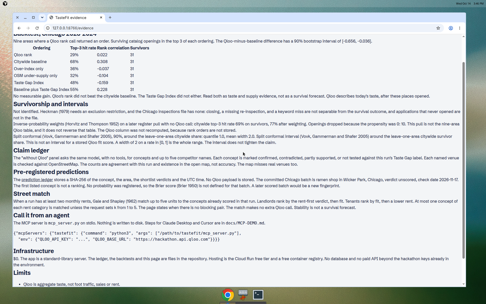
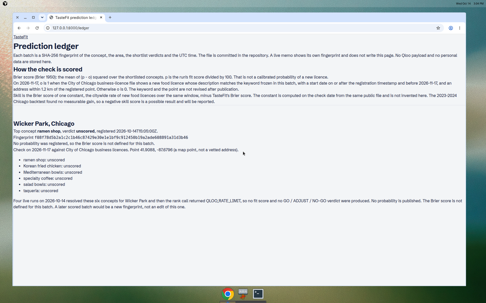

# TasteFit

The only location tool you can prove wrong.

TasteFit tells a restaurant founder or a broker whether a concept fits a street, and it publishes the
checks that can show the answer is wrong. A run makes at most 25 Qloo calls and stops itself at 230
seconds so the memo arrives inside a 300 second host limit. No discounting and no interest.

## Surprise ladder

### 1. What Qloo adds

Qloo's taste graph says what an area's audience over-indexes on, which benchmarks they would rank,
and where that audience is. The page shows each call. The Chicago 2023–2024 backtest is the check:
on nine areas, Qloo's top 3 caught 29% of surviving catalog openings. A citywide baseline caught 68%.
The 90% interval for Qloo minus that baseline is −66 to −4 points. No measurable gain. Qloo is
evidence a broker can show, not a validated predictor of survival.

### 2. Rent-first, then value of information

Where a concept has a Taste Gap label, the rent is checked before taste. An unpayable rent cannot
become a GO. "Check first, before signing" ranks which cost input is worth knowing, in currency per
month (Howard 1966). The figures are monthly. There is no NPV and no interest.

The captured-spend figure is a rough ceiling: equal shares 1/(1+n), which is the conditional logit
when utilities are tied (McFadden 1974). It is not profit.

### 3. Building-wide stable matching

Two or more asking rents on the same street are matched to the concepts that run already scored.
Gale and Shapley (1962), unit-proposing. At most one of each rent category, and at most five units.
No extra Qloo call. The page says when there is no blocking pair. Stability is not a survival forecast.
The score breakdown on a single concept is an exact Shapley split (Shapley 1953) of TasteFit's own
weights, not a cause.

### 4. Self-corrected bias, and an interval that does not get tighter

A Heckman correction (Heckman 1979) is not identified: the Chicago file has no exclusion restriction.
Inverse-probability weights (Horvitz and Thompson 1952) raise the citywide baseline's hit rate from
69% to 77% on a no-Qloo pull. They do not reverse the published Qloo result, which was not recomputed.
The split-conformal interval (Vovk, Gammerman and Shafer 2005) around the citywide share has width 2
on a rate in [0, 1]. It covers the whole range. It does not tighten the claim.

### 5. Pre-registered predictions

Every memo ends with a SHA-256 of the concept, the area, the shortlist verdicts and the UTC time.
The ledger is a file in the repository. The Chicago batch registered on 2026-10-14 is unscored: the
rank call was rate-limited, so no probability was published. The Brier score (Brier 1950) is not
defined for that batch. The check date is 2026-11-17, against Chicago business licences. The first
listed concept is not a ranking.

### 6. Agent-native

`mcp_server.py` exposes `tenant_match`, `city_scan` and `city_scan_unit` over stdio. The steps for
Claude Desktop and Cursor are in `docs/MCP-DEMO.md`. A tool result is not written to disk.

### 7. Evidence page

`/evidence` is linked from the landing page. It shows the backtest table, including the negative
results, the claim ledger's rule (agreement, not accuracy), the ledger, the Gale–Shapley rule, the
MCP snippet, the $0 infrastructure, and the limits.

## Infrastructure

$0. Standard-library server. Committed JSON for the ledger and the backtests. Cloud Run free tier.
No database.

## What not to claim

Do not claim that Qloo predicts which concept will survive. The backtest says it did not beat the
citywide baseline. Do not call the suggested spot a vetted address. Do not treat the unscored
Chicago batch as a probability.

## Screenshots

The evidence page, served locally from the committed backtest files. Qloo's top-3 hit rate is 29%. The citywide baseline is 68%.

The prediction ledger. The Chicago batch is unscored, so the Brier score is not defined. The first listed concept is not a ranking.

## What's next

Not built. Nothing in this section is in the product.

- **Street Exchange.** One match day a month for a city, in the spirit of the medical residency match: vacant units and concepts are matched together on that day.
- **Street health score.** One public number for a block, read off a street certificate.
- **Casablanca pilot.** A first on-the-ground pilot. The Casablanca map pack is already in the repository. The pilot is not.
- **Agent-to-agent leasing.** A broker's agent and a landlord's agent hand a lease across the MCP tools in `docs/MCP-DEMO.md`.

These four are a vision. They are not implemented, not certified, and not a claim about Qloo.
